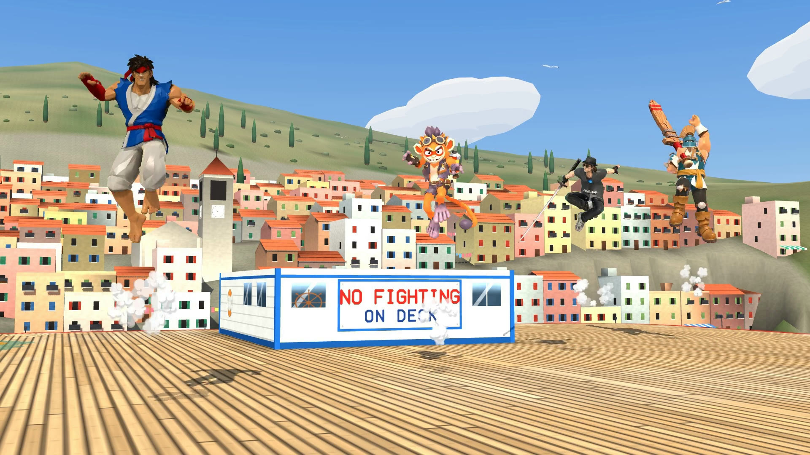

SLOPArena is a free, open-source 3D platform fighter. The idea is a game that belongs to its players, where anyone can make their own characters and the community decides what it becomes. A lot of AI is used to create those characters, and I chose to be honest about that whole process. That feeling of irony honestly is behind the name and was the source of the whole tone of SLOPArena.

In SLOPArena, open source is not just about code: it's about documenting the whole process of creating the game. By showing why and how I did it, I hope to inspire others to take an interest in the project.

## Community first

Too many online games are "queue, play, leave, queue again" without ever talking to another person. A community makes or breaks a game more than anything else, so SLOPArena is built to be social.

- **Rooms instead of a queue.** You browse rooms or make one, let the room leader pick the stage, and rematch with the same people.
- **Chat is part of the game.** More is planned: emotes, friend lists, Discord integration.
- **Community servers.** The plan is the Counter-Strike model: players can host their own servers and run the modes they like. The game scales with its community, not with my server bill.
- **Your feedback steers it.** What you send through the [feedback form](../../feedback/) or say on [Discord ↗](https://discord.gg/VvfaxDCF6Z) decides what I fix and build next.

## For every kind of player

SLOPArena is a PvP game, but it isn't chasing esports. Competition can't be forced, and the first goal is fun. StarCraft 2 is the model. People came for the campaign, the custom games or co-op, got hooked, and only then started climbing the ladder and watching tournaments. That's why there are couch modes like Slopball, Slop Rally and Manki Mayhem next to the fights.

There's a real skill ceiling too. Putting in efforts into a game and being rewarded for it is a nice feeling. Easy to pick up and worth mastering is a hard balance, and it's the one I'm aiming for.

## The most human AI game

"AI slop" is what people call careless AI-generated content. SLOPArena puts it in the name instead of hiding it. AI agents write a lot of the code, build the stages, help make the models and generate a growing share of the animations. That's how one person with a day job can make a 3D online fighter at all.

What makes it human is everything around that. A person decides what gets built, and plays every move before it ships. It's not a one-prompt game. By my count it's closer to 30,000 prompts. All of it, including every tool and every mistake, is documented in the open. And the point of the whole thing is people: playing together, talking in the game, and making their own fighters. [How SLOPArena is made](../how-its-made/) shows the workflow.

## What the game is today

It's a platform fighter in the Smash family, in full 3D. Hits raise your damage percent, and the higher it climbs, the farther you fly. Knock people off the stage to take their stocks, and be the last one standing.

- Seven [fighters](../../fighters/), three of them still being built, and seven stages.
- Online rooms for up to four players, plus Local Play for up to four on one screen.
- An early playtest on Steam, free, by request on the [store page ↗](https://store.steampowered.com/app/5324910/), on Windows.
- A [demo in your browser](/demo), no install needed.

It's unfinished, and the site says so on purpose. A lot more content to come. [How to play](../../play/) covers the controls and the modes.

## Be part of it

- Play, and bring friends.
- Tell me what broke and what felt great on the [feedback form](../../feedback/).
- Hang out on [Discord ↗](https://discord.gg/VvfaxDCF6Z).
- Make a fighter or fix something. [Contribute](../contribute/) shows where to start.

SLOPArena is made by one person. Read [who made this](../who-made-this/).
